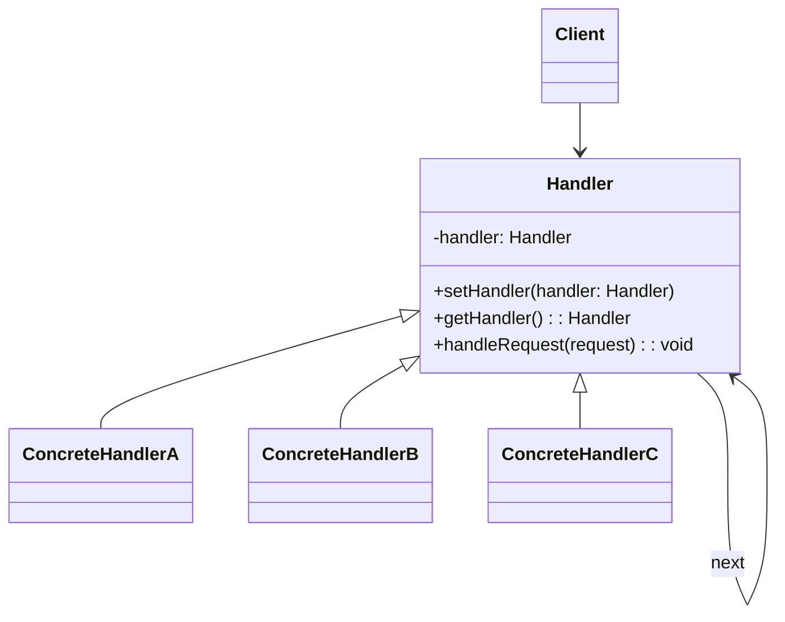

# Chain of Responsibility Design Pattern — Theory Note

## 1. What is the Chain of Responsibility pattern?

The Chain of Responsibility pattern is a behavioral design pattern where a request is passed through a chain of handler objects. Each handler decides whether to process the request or pass it to the next handler in the chain.

This pattern avoids directly coupling the sender of a request to a specific receiver.

## 2. Core idea

A request enters the chain at the first handler. At each stage:
- the handler checks whether it can process the request
- if yes, it handles it and stops
- if no, it forwards the request to the next handler

This creates a flexible processing pipeline.

## 3. Main components

### Handler
The abstract base class or interface that contains a reference to the next handler and declares the method for handling requests.

### ConcreteHandler
A concrete class that implements the handling decision.

### Client
Creates the chain and sends the initial request.

## 4. General class diagram

## 5. When to use it

Use this pattern when:
- multiple objects may handle the same request
- the handler should be chosen dynamically
- you need sequential validation or processing steps
- you want to reduce coupling between sender and receiver
- you want to add or remove handlers without changing client code

## 6. Suitable scenarios

- request validation filters
- authentication and authorization chains
- approval workflows
- middleware in server applications
- logging pipelines
- filtering or preprocessing requests

## 7. Not suitable scenarios

Avoid this pattern when:
- the exact handler is known in advance
- the request must be processed by only one fixed component
- the chain order is not meaningful or stable
- performance is critical and chain traversal is unnecessary
- debugging becomes complicated due to multiple forwarding steps

## 8. Advantages

- loose coupling between sender and handlers
- easy to extend with new handlers
- flexible request handling order
- reduces complex conditional logic in the client

## 9. Disadvantages

- request may go unhandled if no handler accepts it
- harder to debug than a direct call chain
- too many handlers can make the flow complex
- may add unnecessary overhead in simple systems

## 10. Example from this project

This repository demonstrates the pattern through two examples:

### A. Doctor chain
A patient moves from:
- General Doctor
- Specialist
- Consultant

Each doctor checks whether the patient’s condition matches their specialty. If not, the patient is passed to the next doctor.

### B. Servlet filter chain
A request passes through:
- JSP URL validation
- parameter name validation
- parameter value validation

Each filter validates the request and passes it to the next filter if valid.

## 11. Real-world analogy

Think of a customer support system:
- Front desk
- Team lead
- Technical support
- Manager

A complaint moves through the chain until someone resolves it.

## 12. Summary

The Chain of Responsibility pattern is useful when a request should be handled by one of several objects in a sequence. It promotes flexibility, modularity, and decoupling, but it should not be used when a single fixed handler is clearly required.

In short:
"One request, many possible handlers, pass it along until someone handles it."
