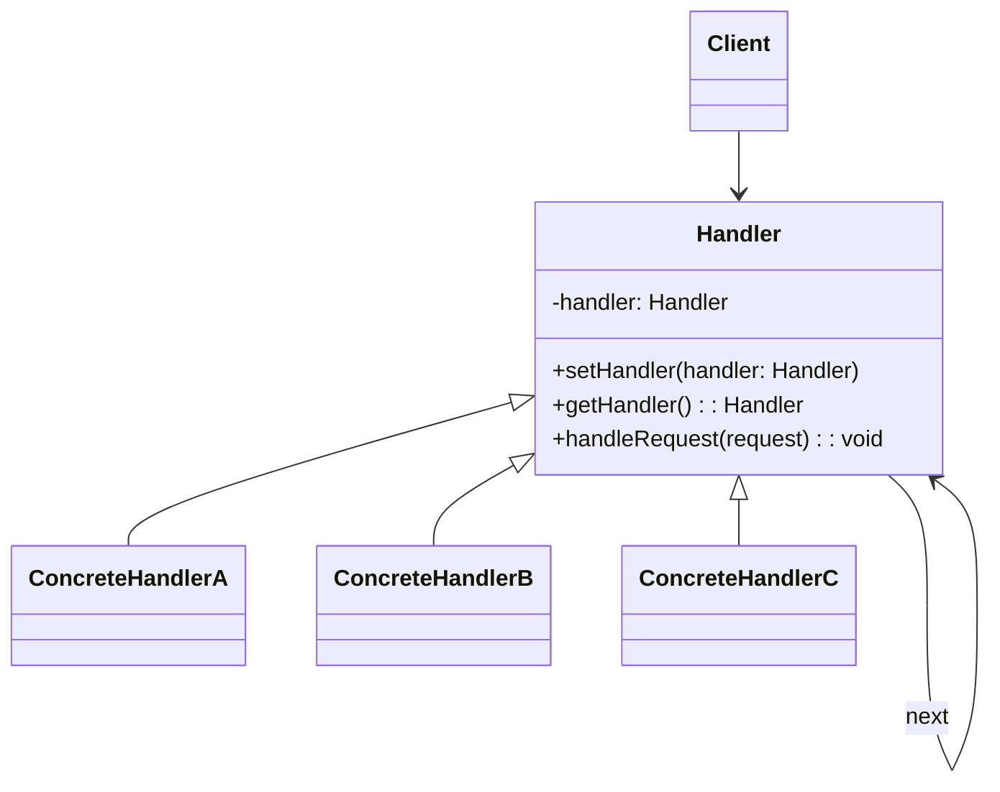

# Chain of Responsibility Design Pattern

## Overview

The Chain of Responsibility pattern is a behavioral design pattern in which a request is passed through a chain of handlers. Each handler decides either to process the request or to forward it to the next handler in the chain.

This pattern is useful when there are multiple possible handlers for a request and the exact handler is not known in advance.

In this project, the pattern is demonstrated using:
- a hospital/doctor chain example
- a servlet filter validation chain example

---

## Theory Note

The Chain of Responsibility pattern allows objects to cooperate to handle a request without tightly coupling the sender to a specific receiver. The sender sends the request to the first handler, and each handler in the chain has the option to:

- handle the request itself
- pass the request to the next handler
- stop processing if the request is handled

This creates a flexible processing pipeline where handlers can be added, removed, or reordered without changing the client code much.

### Main idea

The key idea is that each handler has a reference to the next handler. The request travels through the chain until one handler accepts it or the chain ends.

### Typical flow

1. Client creates a request
2. Client sends the request to the first handler
3. First handler checks if it can process it
4. If yes, it handles it and stops
5. If no, it forwards the request to the next handler
6. This continues until a handler handles it or no handler remains

### Why it is useful

- reduces dependency between sender and receiver
- enables dynamic chaining of responsibilities
- makes adding new handler types easier
- supports sequential validation or filtering logic

### Example in this repository

The `Doctor` chain in `src/main/java/lk/kaushalya/dpII/example/model/Test.java` shows how a patient request passes from a General Doctor to a Specialist to a Consultant.

The `ServletFilter` chain in `src/main/java/lk/kaushalya/dpII/practical/Practical.java` shows a request passing through URL validation, parameter-name validation, and parameter-value validation.

---

## Pattern Structure

Participants in the pattern:

- Handler: declares the interface for handling requests and stores the next handler reference.
- ConcreteHandler: implements the handling logic and decides whether to process or forward the request.
- Client: creates the chain and sends the request.

---

## Suitable Use Cases

The Chain of Responsibility pattern is suitable when:

- multiple objects may handle the same request
- the handler should be chosen dynamically at runtime
- the request passes through a series of validations or approvals
- you want to reduce coupling among sender and receivers
- handlers can be added or removed without affecting client code

### Good examples

- request validation filters
- logging and authentication chains
- approval workflows
- middleware in web applications
- error handling pipelines
- document processing steps

### Real-life analogy

A hospital patient goes through a chain:

- Reception desk
- General doctor
- Specialist
- Consultant

Each level decides whether it can help or needs to pass the patient to the next level.

---

## Not Suitable Use Cases

This pattern is not suitable when:

- the request must be processed by exactly one fixed component only
- the chain order is not clear or may vary unpredictably
- the request processing logic is highly complex and requires direct control flow
- only one handler should always be responsible, not a chain
- performance is critical and unnecessary chain traversal adds overhead

### Anti-pattern signs

Avoid using this pattern when:

- you already know the exact handler before runtime
- the sequence of responsibility is fixed and not flexible
- there is no natural concept of delegation to the next object
- debugging becomes difficult because control flows through multiple handlers

---

## General Class Diagram

### Diagram explanation

- `Handler` defines the interface and holds a reference to the next handler.
- Each `ConcreteHandler` checks whether it can handle the request.
- If not, it forwards the request to `next`.
- The client creates the chain and triggers the request.

---

## Example Flow in This Project

### Hospital example

The patient request starts at `GeneralDoctor`:

- If the symptom is `Fever`, it handles the patient.
- Otherwise, it passes the patient to `Specialist`.
- The `Specialist` checks `Chest Pain` and forwards when needed.
- The `Consultant` handles `Heart Disease` or marks the patient as unhandled.

### Servlet filter example

The request starts with `JSPValidationFilter`:

- checks URL extension
- passes to `ParameterNameValidationFilter`
- then to `ParameterValueValidationFilter`

This matches the idea of middleware or filters in web applications.

---

## Advantages

- decouples sender from specific handlers
- easy to add/remove handlers
- supports sequential processing or validation steps
- reduces conditional complexity in client code
- promotes extensibility

## Disadvantages

- request may go unhandled if the chain is incomplete
- debugging may be harder because control flows through multiple objects
- may create a complex chain if too many handlers are added
- not ideal when all requests should be handled by a single fixed object

---

## Conclusion

The Chain of Responsibility pattern is a good choice when request handling should be distributed across multiple objects in a flexible sequence. It is especially useful for validation, filtering, approval systems, and middleware chains.

However, it should be used carefully when processing must be deterministic, strictly single-step, or highly performance-sensitive.

This repository demonstrates the pattern clearly through both a medical-chain example and a servlet-filter chain example.

---

## Sinhala Summary

Chain of Responsibility pattern එකේ මූලික අදහස වන්නේ, request එකක් එක් handler එකකින් තාම නොගැලපුණොත් ඊළඟ handler එකට යැවීමයි. එය validation, filter, approval, middleware වැනි අවස්ථා වල ඉතා හොඳින් භාවිතා වේ.

මෙම pattern එක සුදුසු වන්නේ:
- multiple handlers exist
- request එකට එකකට වඩා වැඩි විසඳුම් තිබේ
- responsibilities chain එකක් ලෙස run වෙන්නේ නම්

මෙය සුදුසු නොවන්නේ:
- request එක විනිශ්චය කරන handler එකක් දැනටමත් තීරණය කර තිබේ නම්
- එක් handler එකක් පමණක් හැසිරවිය යුතු නම්
- chain එකක through වෙමින් debug කිරීම අසීලයි නම්

---

## Project Files Related to This Pattern

- `src/main/java/lk/kaushalya/dpII/example/model/Test.java`
- `src/main/java/lk/kaushalya/dpII/practical/Practical.java`

These files show how the Chain of Responsibility pattern can be implemented in Java.
